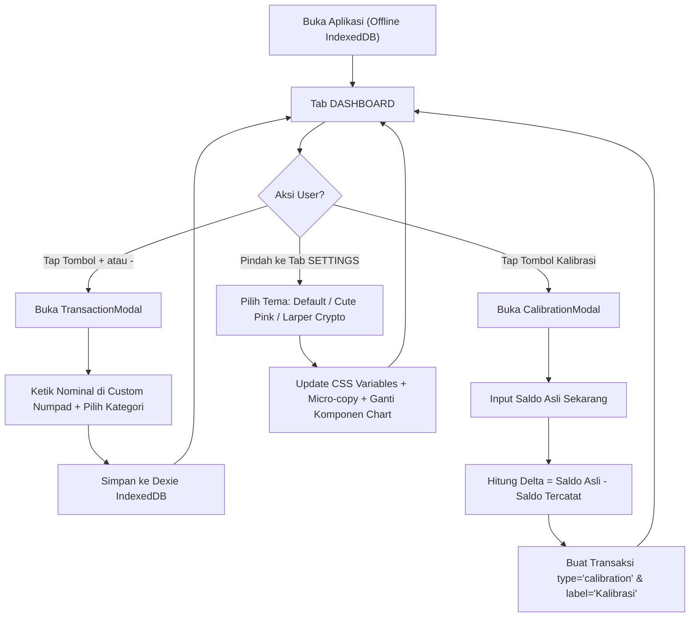

# PRD: Defisit Harian

## 1. Visi Produk & Batasan Ruang Lingkup (Scope Definition)

### 1.1 Visi Produk
**Defisit Harian** adalah aplikasi Android pencatat keuangan pribadi berbasis **offline-first** (100% penyimpanan lokal di perangkat, tanpa akun, tanpa server cloud) yang mengutamakan kecepatan input (< 3 detik per transaksi) dan memiliki **Theme Morphing Engine** 3 wajah:
1. **Simple Default**: UI finansial minimalis modern dengan grafik gunung-gunung (*smooth area spline chart*).
2. **Cute Pink Lucu**: UI kawaii pastel dengan bahasa ramah dan grafik gunung-gunung bernuansa *cotton candy*.
3. **Larper Crypto (Bybit-Style Trading UI)**: Mengubah tampilan catatan keuangan harian menjadi terminal *crypto exchange* ala Bybit lengkap dengan **OHLC Candlestick Chart** interaktif dari riwayat saldo pribadi, metrik *Total Equity*, serta *Today's PnL (%)*.

### 1.2 Batasan Ruang Lingkup (In-Scope vs Out-of-Scope)
Tabel ini adalah kontrak mutlak bagi AI Eksekutor. **Dilarang keras** menambahkan fitur di luar kolom *In-Scope*.

| Kategori | IN-SCOPE (Wajib Dibuat) | OUT-OF-SCOPE (Dilarang Dibuat / Over-Engineering) |
| :--- | :--- | :--- |
| **Autentikasi & Cloud** | Tanpa login, langsung masuk Dashboard. Data 100% di IndexedDB (`Dexie.js`). | Login, Register, Firebase, Supabase, sinkronisasi cloud, PIN/Biometric lock. |
| **Mata Uang** | Hanya Rupiah (`IDR`), bilangan bulat positif (`integer >= 0`), format titik ribuan (`1.250.000`). | Multi-currency, konversi kurs live, angka desimal sen untuk nominal Rupiah. |
| **Transaksi** | Tipe `income` (`+`), `expense` (`-`), dan `calibration` (`+`/`-`). Tambah, Edit, Hapus. | Recurring/jadwal otomatis, split bill, foto struk OCR, lampiran gambar, multi-wallet/rekening. |
| **Kategori** | 11 kategori *built-in* (termasuk 1 kategori sistem `Kalibrasi`) dengan ikon `lucide-react`. | CRUD kategori kustom oleh user (untuk menjaga kesederhanaan UI dan mencegah bug relasi). |
| **Visualisasi Grafik** | **Area Spline Chart** (untuk tema `default` & `cute-pink`) dan **OHLC Candlestick Chart** (untuk tema `crypto-larp`). | Pie chart kategori, bar chart bulanan, indikator teknikal kompleks (RSI, MACD, Bollinger Bands). |
| **Kalibrasi Saldo** | Input saldo aktual saat ini -> hitung selisih (`delta`) -> buat transaksi `calibration` otomatis + opsi toggle masuk/tidak ke statistik pemasukan/pengeluaran. | Rekonsiliasi mutasi bank otomatis, import CSV/PDF mutasi bank. |
| **Backup & Restore** | Export seluruh DB ke 1 file `.json` (via Android Share Sheet / Web Download) & Import `.json` dengan validasi skema. | Auto-backup ke Google Drive, export Excel/PDF. |

---

## 2. Daftar Layar & Navigasi (Screen Map & User Flow)

Aplikasi menggunakan pola **Single-Page Application (SPA)** berbasis state `activeTab` dan modal/bottom-sheet overlay (tanpa `react-router-dom` agar ringan dan bebas masalah routing file-path di WebView Android Capacitor).

### 2.1 Peta Layar & Komponen Overlay
1. **Main Shell (`App.tsx`)**:
   - **Top Header Bar**: Menampilkan judul aplikasi/pair (`Defisit Harian` / `Dompet Imutku` / `IDR/USDT Perp`), badge tema aktif, dan tombol cepat buka **Modal Kalibrasi**.
   - **Tab 1 — `DASHBOARD` (Beranda & Grafik)**:
     - **Summary Card**: Menampilkan *Total Saldo*, *Net Cashflow / PnL Periode*, *Total Pemasukan (`+`)*, dan *Total Pengeluaran (`-`)*.
     - **Period Filter Bar**: Pilihan rentang waktu (`TODAY` / `7D` / `30D` / `ALL`) untuk tema Default & Cute Pink, atau (`1D` / `1W` / `1M`) untuk mode Candlestick Larper Crypto.
     - **Dynamic Chart Container**: Merender `AreaBalanceChart` jika tema `default` atau `cute-pink`, dan merender `CryptoCandlestickChart` jika tema `crypto-larp`.
     - **Quick Action Bar**: 2 tombol utama berukuran besar untuk memicu input transaksi: Tombol **`+` (Income)** dan Tombol **`-` (Expense)**.
     - **Recent Transactions Preview**: Menampilkan 5 transaksi terbaru + tombol `"Lihat Semua"` yang memindahkan tab ke `HISTORY`.
   - **Tab 2 — `HISTORY` (Riwayat Transaksi Lengkap)**:
     - **Filter Tipe**: Pill filter (`Semua`, `Pemasukan (+)`, `Pengeluaran (-)`, `Kalibrasi`).
     - **Search Bar Sederhana**: Filter berdasarkan teks catatan (`note`) atau nama kategori.
     - **Chronological Transaction List**: Daftar transaksi diurutkan dari `timestamp` terbaru ke terlama. Klik item membuka **Modal Form Transaksi (Mode Edit)** atau tombol hapus.
   - **Tab 3 — `SETTINGS` (Pengaturan & Backup)**:
     - **Theme Selector Cards**: 3 kartu pilihan tema (`Simple Default`, `Cute Pink Lucu`, `Larper Crypto`).
     - **Calibration Stat Toggle**: Switch untuk mengatur `includeCalibrationInStats` (apakah transaksi kalibrasi dihitung ke dalam total pemasukan/pengeluaran).
     - **Backup & Restore Panel**: Tombol `"Export Backup (.json)"` dan `"Import / Restore (.json)"`.
2. **Modal 1 — `TransactionModal` (Bottom Sheet Input/Edit `+` & `-`)**:
   - Toggle Tipe (`income` / `expense`).
   - Display Nominal Besar dengan format ribuan otomatis (`Rp 0`).
   - Horizontal/Grid Category Picker (ikon + label singkat).
   - Input Catatan singkat (opsional, maks 100 karakter) & Input Waktu (`datetime-local`, default waktu sekarang).
   - Custom Built-in Numpad (`0-9`, `000`, `Backspace`, `Simpan`) agar tidak terganggu keyboard bawaan OS.
3. **Modal 2 — `CalibrationModal` (Dialog Kalibrasi Saldo)**:
   - Menampilkan `Saldo Tercatat Saat Ini`.
   - Input nominal `Saldo Asli Sekarang` (menggunakan numpad kustom).
   - Live preview `Selisih (Delta)`: menampilkan `+Rp X` (hijau) atau `-Rp X` (merah).
   - Tombol `"Terapkan Kalibrasi"`.
4. **Modal 3 — `RestoreConfirmModal` (Dialog Konfirmasi Restore JSON)**:
   - Menampilkan ringkasan isi file backup (tanggal backup, jumlah transaksi, tema tersimpan).
   - Peringatan bahwa data lokal saat ini akan ditimpa sepenuhnya.
   - Tombol `"Batal"` dan `"Timpa & Restore"`.

### 2.2 Diagram Alur Pengguna (User Flow)

---

## 3. Spesifikasi Fungsional per Fitur, Edge Cases & Acceptance Criteria

### 3.1 Fitur 1: Pencatatan Pemasukan (`+`) & Pengeluaran (`-`) Simpel
- **Spesifikasi**:
  - Saat user menekan tombol `+` di Dashboard, `TransactionModal` terbuka dengan state awal `type = 'income'`, kategori default `cat_salary` (Gaji).
  - Saat user menekan tombol `-` di Dashboard, `TransactionModal` terbuka dengan state awal `type = 'expense'`, kategori default `cat_food` (Makan).
  - Custom Numpad memiliki tombol: `1`, `2`, `3`, `4`, `5`, `6`, `7`, `8`, `9`, `000`, `0`, `⌫` (hapus 1 digit terakhir).
  - Batas maksimum nominal per transaksi adalah `999_999_999_999` (999 Miliar Rupiah) untuk mencegah integer overflow.
- **Edge Cases**:
  - Jika nominal masih `0`, tombol `"Simpan"` dalam keadaan `disabled`.
  - Jika user menekan `0` atau `000` saat nilai saat ini `0`, nilai tetap `0` (tidak menjadi `000`).
  - Jika user mengedit transaksi bertipe `calibration` dari halaman History, user hanya diizinkan **menghapus** transaksi kalibrasi tersebut atau mengedit **catatan (`note`)**-nya; tipe dan nominal kalibrasi dikunci agar integritas histori kalibrasi terjaga.
- **Acceptance Criteria**:
  1. User dapat mencatat pengeluaran makan Rp 25.000 hanya dengan: Tap `-` -> Tap `2`, `5`, `000` -> Tap `Simpan` (total 5 ketukan jari, < 3 detik).
  2. Display nominal langsung memformat angka menjadi `Rp 25.000` setiap kali tombol numpad ditekan.
  3. Setelah disimpan, modal tertutup, saldo total, statistik, daftar riwayat, dan grafik langsung ter-update secara reaktif.

### 3.2 Fitur 2: Dashboard, Grafik Gunung-Gunung & History
- **Spesifikasi**:
  - **Total Saldo (`currentBalance`)**: Selalu dihitung dari **seluruh** transaksi sepanjang waktu (`ALL`), termasuk transaksi bertipe `calibration`:
    `Total Saldo = Sum(Transaksi direction='in') - Sum(Transaksi direction='out')`
  - **Filter Periode (`TODAY`, `7D`, `30D`, `ALL`)**:
    - `TODAY`: Mulai pukul `00:00:00.000` hari ini hingga `23:59:59.999` hari ini (waktu lokal perangkat).
    - `7D`: Mulai pukul `00:00:00.000` pada `hari ini - 6 hari` (total 7 hari kalender termasuk hari ini).
    - `30D`: Mulai pukul `00:00:00.000` pada `hari ini - 29 hari` (total 30 hari kalender termasuk hari ini).
    - `ALL`: Dari transaksi paling awal hingga hari ini (minimal menampilkan rentang 7 hari terakhir jika baru ada 1 hari transaksi).
  - **Total Pemasukan Periode (`periodIncome`) & Total Pengeluaran Periode (`periodExpense`)**:
    - Jika `settings.includeCalibrationInStats === false` (default): hanya menjumlahkan transaksi dalam rentang periode yang memiliki `type === 'income'` (untuk pemasukan) dan `type === 'expense'` (untuk pengeluaran). Transaksi `type === 'calibration'` diabaikan dari kedua angka ini.
    - Jika `settings.includeCalibrationInStats === true`: transaksi `calibration` dengan `direction === 'in'` ikut ditambahkan ke `periodIncome`, dan `calibration` dengan `direction === 'out'` ikut ditambahkan ke `periodExpense`.
  - **Net Cashflow Periode (`periodNet`)**: `periodIncome - periodExpense`.
  - **Persentase PnL Periode (`periodPnlPercent` - khusus ditampilkan menonjol di tema `crypto-larp`)**:
    - Jika saldo awal periode (`openingBalance`) > 0: `((currentBalance - openingBalance) / openingBalance) * 100`.
    - Jika `openingBalance === 0` dan `currentBalance > 0`: `+100.00%`.
    - Jika `openingBalance === 0` dan `currentBalance < 0`: `-100.00%`.
    - Jika `openingBalance === 0` dan `currentBalance === 0`: `0.00%`.
- **Edge Cases**:
  - Saat aplikasi baru diinstal dan belum ada transaksi sama sekali (`transactions.length === 0`), grafik menampilkan garis datar pada nilai `0` untuk 7 hari terakhir (Area) atau 30 hari terakhir (Candlestick) tanpa crash.
  - Jika saldo menjadi negatif (defisit), grafik gunung-gunung dan candlestick tetap merender angka negatif dengan benar tanpa error.
- **Acceptance Criteria**:
  1. Pada tema `default` dan `cute-pink`, grafik merender kurva gunung-gunung halus (*smooth curved area chart*) dengan gradien vertikal di bawah garis.
  2. Pada History, setiap baris transaksi menampilkan ikon kategori, nama kategori, catatan, tanggal & jam (`DD MMM YYYY, HH:mm`), serta nominal berwarna hijau dengan prefix `+Rp` untuk `direction === 'in'` atau merah dengan prefix `-Rp` untuk `direction === 'out'`.
  3. Transaksi bertipe `calibration` memiliki badge khusus bertuliskan `"KALIBRASI"` (atau `"KOREKSI ✨"` / `"REBALANCE"` sesuai tema).

### 3.3 Fitur 3: Kalibrasi Saldo (Balance Calibration)
- **Spesifikasi**:
  - User menekan tombol `"Kalibrasi"` di Header.
  - Modal menampilkan saldo tercatat saat ini (`currentRecordedBalance`).
  - User memasukkan nominal saldo nyata yang ada di dompet/rekeningnya saat ini (`actualBalance`).
  - Sistem menghitung `delta = actualBalance - currentRecordedBalance`.
  - Sistem menyimpan objek `Transaction` baru dengan:
    - `type: 'calibration'`
    - `direction: delta > 0 ? 'in' : 'out'`
    - `amount: Math.abs(delta)`
    - `categoryId: 'cat_calibration'`
    - `note: 'Kalibrasi'`
    - `timestamp: Date.now()`
    - `metadata: { previousBalance: currentRecordedBalance, actualBalance: actualBalance, delta: delta }`
- **Edge Cases**:
  - Jika `delta === 0` (`actualBalance === currentRecordedBalance`), tombol `"Terapkan Kalibrasi"` disabled / tidak membuat transaksi baru dan menampilkan pesan `"Saldo sudah sesuai (selisih Rp 0)"`.
  - Jika saldo tercatat saat ini negatif (misal `-Rp 50.000`) dan user mengkalibrasi menjadi `Rp 100.000`, maka `delta = 100000 - (-50000) = +150000` (`direction: 'in'`, `amount: 150000`).
- **Acceptance Criteria**:
  1. Jika saldo tercatat `Rp 500.000` dan user menginput saldo asli `Rp 350.000`, sistem otomatis membuat 1 entri riwayat `"Kalibrasi"` bernilai `-Rp 150.000`.
  2. Setelah kalibrasi tersebut, Total Saldo langsung menjadi `Rp 350.000`, tetapi Total Pengeluaran (`-`) pada Dashboard **tidak bertambah** Rp 150.000 selama toggle `includeCalibrationInStats` bernilai `false`.

### 3.4 Fitur 4: Backup & Restore Simpel (Offline-First)
- **Spesifikasi**:
  - **Export**: Mengambil seluruh isi tabel `transactions`, `categories`, dan `settings` dari Dexie, membungkusnya ke dalam struktur JSON `BackupPayload` (`app: 'defisit-harian'`, `version: 1`, `exportedAt: ISOString`), lalu:
    - Jika berjalan di Capacitor Android (`Capacitor.isNativePlatform() === true`): Menulis file `defisit-harian-backup-YYYY-MM-DD.json` ke `Directory.Cache` menggunakan `@capacitor/filesystem`, lalu memanggil `Share.share()` dari `@capacitor/share`.
    - Jika berjalan di Web Browser biasa: Memicu download file `.json` menggunakan `Blob` dan elemen `<a download>`.
  - **Import / Restore**:
    - Membuka file picker `<input type="file" accept=".json,application/json" />`.
    - Membaca isi teks file, memvalidasi struktur JSON secara ketat (`app === 'defisit-harian'`, `version === 1`, array `transactions` dengan field valid, dan object `settings`).
    - Jika valid, menampilkan `RestoreConfirmModal`. Saat user menekan `"Timpa & Restore"`, sistem menjalankan transaksi database atomic (`db.transaction('rw', ...)`) untuk menghapus data lama dan memasukkan data dari file backup.
- **Edge Cases**:
  - File bukan JSON atau struktur rusak: Tampilkan alert error yang jelas dan batalkan proses tanpa menyentuh data yang ada.
- **Acceptance Criteria**:
  1. File JSON hasil export dapat di-import kembali dan mengembalikan 100% transaksi, saldo, serta tema yang aktif persis seperti semula.

### 3.5 Fitur 5: Sistem Pengaturan 3 Tema (Theme Morphing Engine) & Candlestick Larper Crypto
- **Spesifikasi**:
  - Mengubah tema (`default`, `cute-pink`, `crypto-larp`) langsung mengubah atribut `data-theme="<themeId>"` pada elemen `document.documentElement` (`<html>`) dan menyimpan pilihan ke tabel `settings` di IndexedDB.
  - Pada tema `crypto-larp`:
    - Komponen chart berganti menjadi `CryptoCandlestickChart` berbasis `lightweight-charts`.
    - Tersedia pemilih timeframe candle: **`1D` (Harian)**, **`1W` (Mingguan)**, **`1M` (Bulanan)**.
    - Menampilkan header ala Bybit: Ticker `IDR/USDT Perp`, indikator `HIGH` dan `LOW` dari candle terakhir, serta live OHLC crosshair legend.
- **Acceptance Criteria**:
  1. Pergantian tema berlangsung instan (< 50ms) tanpa reload halaman dan tanpa mengubah data transaksi di database.
  2. Pada tema `crypto-larp`, user dapat melakukan zoom, pan kiri-kanan pada chart candlestick, dan menyentuh candle untuk melihat nilai `O`, `H`, `L`, `C` pada *crosshair legend* di bagian atas chart.

---

## 4. Matriks Design System untuk 3 Tema

### 4.1 Tabel Token Visual & Tipografi (CSS Variables Mapping)
Semua warna di bawah ini **WAJIB** didefinisikan di `src/index.css` sebagai CSS Variables agar komponen React cukup memanggil `bg-[var(--bg-primary)]`, `text-[var(--text-primary)]`, dll.

| Token CSS Variable | Tema 1: `default` (Simple Default) | Tema 2: `cute-pink` (Cute Pink Lucu) | Tema 3: `crypto-larp` (Larper Crypto - Bybit) |
| :--- | :--- | :--- | :--- |
| `--bg-primary` (Latar Utama) | `#F8FAFC` (Slate 50) | `#FFF0F5` (Lavender Blush) | `#0B0E11` (Bybit Deep Black) |
| `--bg-surface` (Kartu / Panel) | `#FFFFFF` (Pure White) | `#FFFFFF` (White + Pink Tint) | `#161A1E` (Bybit Dark Surface) |
| `--bg-elevated` (Input / Pill) | `#F1F5F9` (Slate 100) | `#FFE4EE` (Soft Pink Pill) | `#1E2329` (Bybit Orderbook Gray) |
| `--text-primary` (Teks Utama) | `#0F172A` (Slate 900) | `#592E3E` (Deep Berry Brown) | `#EAECEF` (Bybit Off-White) |
| `--text-secondary` (Subteks) | `#64748B` (Slate 500) | `#A66E82` (Muted Rose) | `#848E9C` (Bybit Muted Gray) |
| `--accent-primary` (Aksen Utama) | `#2563EB` (Royal Blue 600) | `#FF69B4` (Hot Pink Kawaii) | `#F7A600` (Bybit Gold / Yellow) |
| `--accent-text` (Teks di atas Aksen) | `#FFFFFF` | `#FFFFFF` | `#0B0E11` (Kontras gelap di atas emas) |
| `--color-positive` (`+` / Bullish) | `#10B981` (Emerald 500) | `#22C55E` (Mint Green) | `#00C076` (Bybit Bullish Green) |
| `--color-negative` (`-` / Bearish) | `#EF4444` (Red 500) | `#FB7185` (Rose 400) | `#F6465D` (Bybit Bearish Red) |
| `--border-color` (Garis Tepi) | `#E2E8F0` (Slate 200) | `#FBCFE8` (Pink 200) | `#2B3139` (Bybit Hairline Border) |
| `--chart-grid` (Garis Grid Chart) | `#F1F5F9` | `#FCE7F3` | `#1E2329` |
| `--chart-area-top` (Gradien Atas) | `rgba(37, 99, 235, 0.35)` | `rgba(255, 105, 180, 0.40)` | `rgba(247, 166, 0, 0.25)` |
| `--chart-area-bottom` (Gradien Bawah) | `rgba(37, 99, 235, 0.02)` | `rgba(255, 105, 180, 0.04)` | `rgba(247, 166, 0, 0.00)` |
| `--radius-card` (Sudut Kartu) | `12px` | `24px` | `4px` |
| `--radius-button` (Sudut Tombol) | `10px` | `9999px` | `4px` |
| `--font-sans` (Font UI) | `'Inter', system-ui, sans-serif` | `'Quicksand', 'Nunito', sans-serif` | `'Inter', system-ui, sans-serif` |
| `--font-mono` (Font Angka/Harga) | `'Inter', system-ui, sans-serif` | `'Quicksand', sans-serif` | `'JetBrains Mono', monospace` |
| `--shadow-card` (Bayangan Kartu) | `0 1px 3px rgba(15,23,42,0.06)` | `0 8px 20px rgba(255,105,180,0.14)` | `none` |

### 4.2 Matriks Micro-Copy untuk 3 Tema (`THEME_COPY` Dictionary)
Setiap label teks di UI **dilarang di-hardcode** di dalam JSX; komponen wajib membaca dari kamus `THEME_COPY[themeId]`:

| Key Dictionary | Tema 1: `default` | Tema 2: `cute-pink` | Tema 3: `crypto-larp` |
| :--- | :--- | :--- | :--- |
| `appTitle` | `Defisit Harian` | `Dompet Imutku ✨` | `IDR/USDT Perp` |
| `appSubtitle` | `Catatan Keuangan Pribadi` | `Tabungan & Jajan Harian 🌸` | `Bybit Spot & Margin Simulator` |
| `balanceLabel` | `Total Saldo Saat Ini` | `Isi Celengan Sekarang 💖` | `Total Equity (IDR)` |
| `netFlowLabel` | `Net Cashflow` | `Sisa Uang Jajan` | `Today's PnL` |
| `incomeStatLabel` | `Total Pemasukan (+)` | `Uang Masuk (+)` | `Total Deposit / Long` |
| `expenseStatLabel` | `Total Pengeluaran (-)` | `Uang Jajan (-)` | `Total Withdraw / Short` |
| `btnAddIncome` | `+ Pemasukan` | `+ Tambah Tabungan` | `Buy / Deposit` |
| `btnAddExpense` | `- Pengeluaran` | `- Catat Jajan` | `Sell / Withdraw` |
| `btnCalibrate` | `Kalibrasi Saldo` | `Cocokkan Celengan 🪄` | `Margin Rebalance` |
| `chartTitle` | `Tren Gunung Saldo` | `Gunung Tabunganku ⛰️💕` | `IDR/EQUITY OHLC Chart` |
| `historyTitle` | `Riwayat Transaksi` | `Catatan Jajanku 📖` | `Order & Trade History` |
| `calibrationBadge` | `KALIBRASI` | `KOREKSI ✨` | `REBALANCE` |
| `emptyHistoryText` | `Belum ada transaksi tercatat.` | `Masih kosong nih, yuk catat! 🌸` | `No active orders or trade history.` |
| `tabDashboard` | `Dashboard` | `Beranda` | `Trade / Chart` |
| `tabHistory` | `Riwayat` | `Catatan` | `Orders` |
| `tabSettings` | `Pengaturan` | `Tema & Data` | `Terminal Config` |
